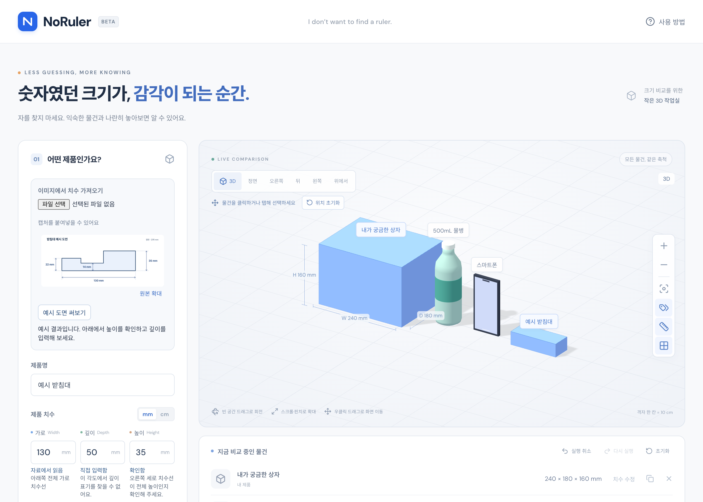
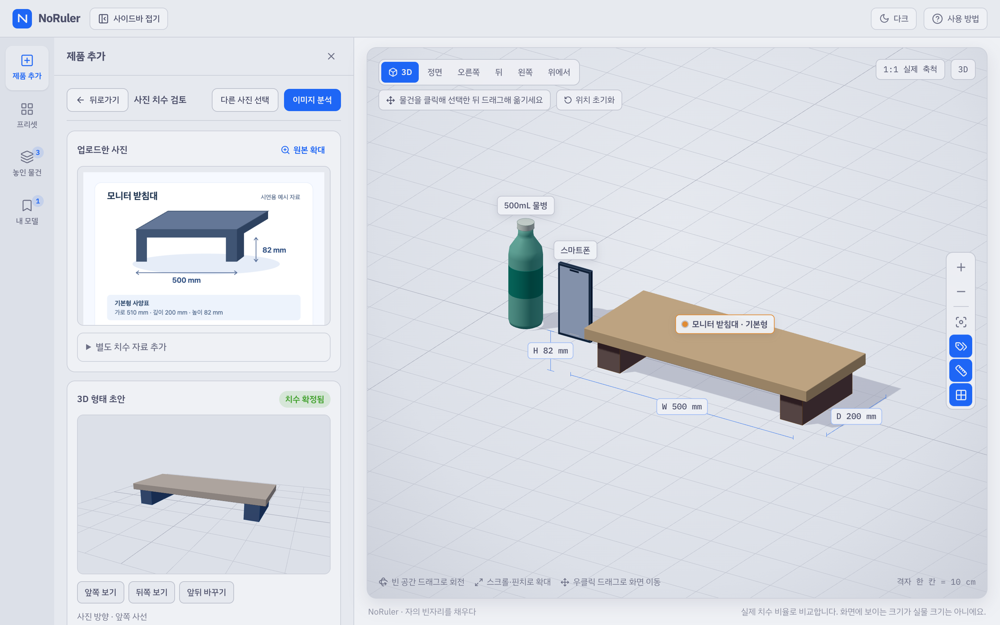
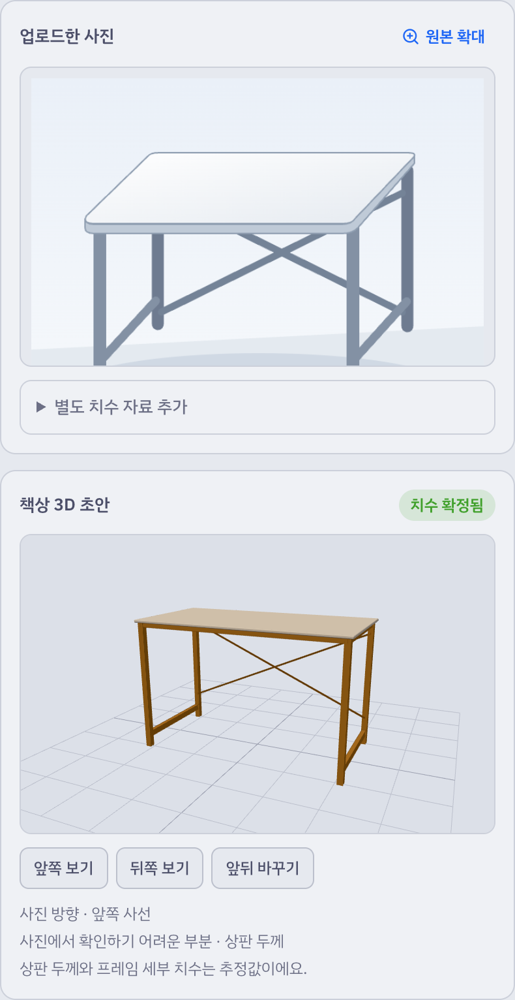
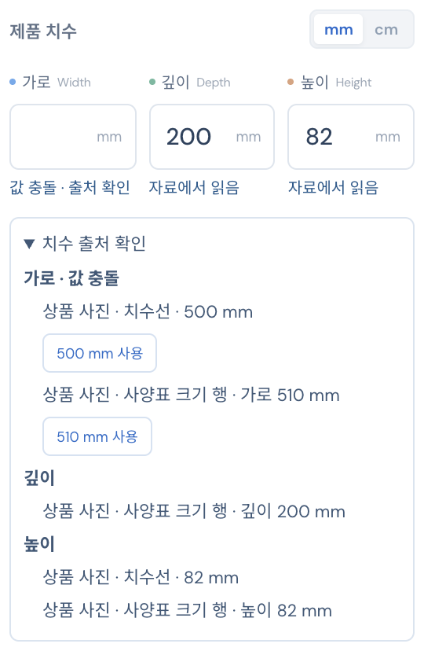
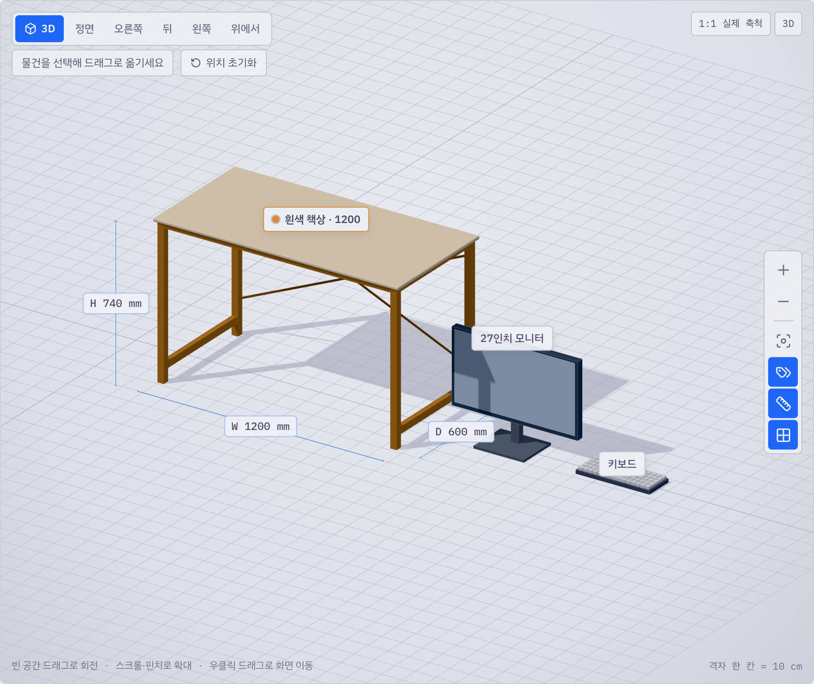
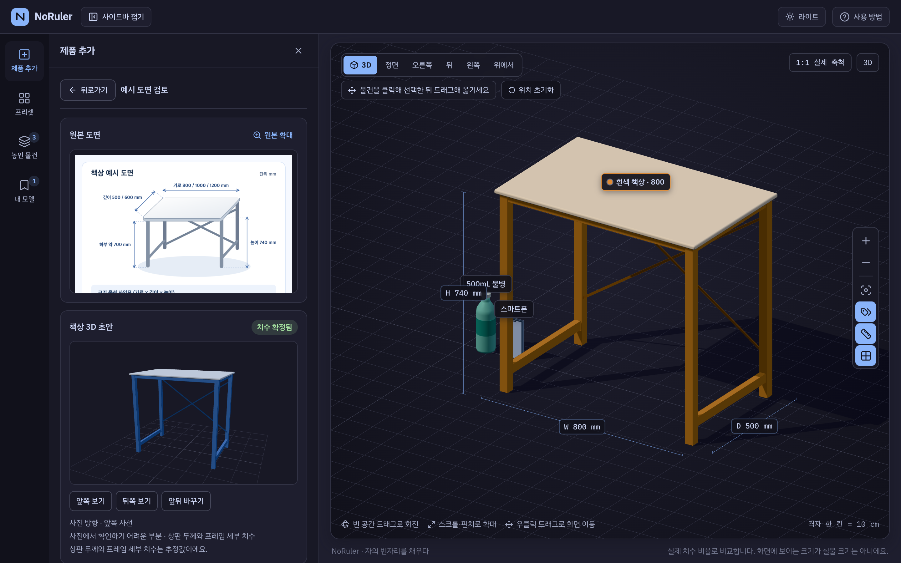
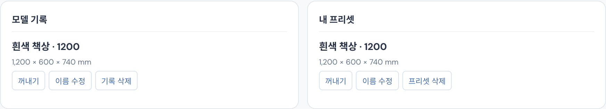
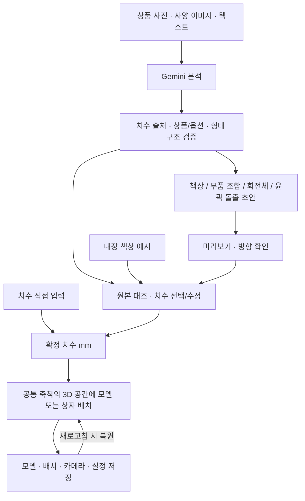

# NoRuler

> I don't want to find a ruler.

상품 사진·도면·사양표에서 치수와 형태를 확인하고, 익숙한 물건과 같은 축척의 3D 공간에서 크기를 비교합니다. 사진에서 만든 3D 초안과 직접 입력한 크기 상자를 함께 놓고 옮기거나 돌려 볼 수 있습니다.

[**브라우저에서 바로 체험하기**](https://noruler-aaf.pages.dev) · [사용 방법](#빠른-시작) · [배포 가이드](docs/DEPLOY_CLOUDFLARE.md)

공개 데모에서는 설치나 API 키 입력 없이 내장 예시·직접 입력·실제 이미지 분석을 사용할 수 있습니다. 이미지 분석에는 보안 확인과 요청 횟수 제한이 적용되며, 한도에 도달해도 예시와 직접 입력은 계속 사용할 수 있습니다.



**MIT · Node.js ≥ 22.18 · React + TypeScript + Three.js**

## 왜 만들었나요?

온라인 쇼핑에서 `50 × 20 × 8.2 cm`라는 숫자만 보고 모니터 받침대가 실제로 얼마나 큰지 감을 잡기는 어렵습니다. 상세 페이지에는 상품 사진, 치수선, 사양표가 섞여 있고 같은 상품에도 크기 옵션이 여러 개 있습니다. NoRuler는 치수의 출처를 직접 확인하고, 그 크기를 물병·스마트폰 같은 익숙한 물건 옆에 놓아 비교할 수 있게 만든 도구입니다.

| 확인할 일 | NoRuler에서 |
| --- | --- |
| 제품 전체 치수 찾기 | 상품·옵션별 치수 후보와 출처를 축별로 확인 |
| 표기된 값이 다르거나 축이 없을 때 | 근거를 대조해 값을 고르고 가로·깊이·높이에 배정 |
| 크기와 형태 가늠하기 | 공통 축척의 3D 공간에서 제품과 프리셋을 함께 배치 |
| 다음에 다시 비교하기 | 모델 기록·내 프리셋과 배치를 브라우저에 저장 |

## 빠른 시작

설치 없이 사용하려면 [공개 데모](https://noruler-aaf.pages.dev)를 엽니다. 아래 명령은 소스코드를 내려받아 로컬에서 실행할 때 사용합니다.

**준비물:** Node.js 22.18 이상, WebGL 2 지원 브라우저. 로컬에서 실제 상품 이미지를 분석하려면 Gemini API 키가 필요합니다.

Windows에서는 PowerShell 또는 명령 프롬프트, macOS·Linux에서는 터미널을 열고 프로젝트 폴더로 이동합니다.

```sh
npm install
npm run dev
```

프로젝트 폴더에서 실행한 뒤 터미널에 표시된 `Local` 주소(기본값 `http://127.0.0.1:5173`)를 엽니다. API 키 없이도 내장 예시 도면과 직접 입력 기능을 사용할 수 있습니다. 서버는 실행한 컴퓨터에서만 접속하도록 설정되어 있습니다.

### 예시 책상 도면으로 체험

1. **제품 추가 → 사진·도면으로 가져오기 → 예시 도면 써보기**를 누릅니다.
2. 기본 `800 × 500 × 740 mm` 책상의 원본 도면과 회전 가능한 **책상 3D 초안**을 확인합니다. `1000 × 600 × 740 mm`, `1200 × 600 × 740 mm` 옵션도 선택할 수 있습니다.
3. 필요하면 **원본 확대**, **앞쪽 보기 / 뒤쪽 보기**, **앞뒤 바꾸기**로 치수와 방향을 확인합니다.
4. **책상을 비교 공간에 추가**를 누릅니다. **프리셋** 탭에서 비교할 물건을 추가하고, **놓인 물건** 탭에서 물건을 선택해 복제·치수 수정·제거를 할 수 있습니다.

내장 예시의 치수는 확인된 값으로 제공됩니다. 값을 수정하거나 축을 바꾸면 변경된 상태가 표시되며, 확인이 필요한 축은 검토한 뒤 추가합니다. **뒤로가기**를 누르면 이미지 검토를 종료합니다.

### 치수 직접 입력

**제품 추가 → 치수 직접 입력**에서 제품명과 가로·깊이·높이를 입력하고 **3D로 크기 비교하기**를 누릅니다. 입력한 외곽 크기의 3D 상자가 추가됩니다. 단위는 `mm`와 `cm`를 지원하며, 전환해도 실제 크기는 유지됩니다.

### 실제 상품 이미지 분석 (로컬 설정)

공개 데모는 서버에 설정된 키로 분석합니다. 로컬에서 분석하려면 프로젝트 루트에 `.env.local`을 만들고 API 키를 넣습니다. 필요한 변수는 [.env.example](.env.example)에서도 확인할 수 있습니다.

```dotenv
GEMINI_API_KEY=발급받은_키
```

개발 서버를 재시작한 뒤 다음 순서로 진행합니다.

1. **사진·도면으로 가져오기**에서 PNG·JPG·WebP 이미지를 선택합니다. 끌어다 놓기와 캡처 붙여넣기도 지원하며, 이미지당 최대 8 MB입니다.
2. 필요하면 **별도 치수 자료 추가**에서 사양표 이미지나 치수 텍스트를 첨부합니다.
3. **이미지 분석**을 누르고, 상품이나 크기 옵션이 여러 개라면 비교할 대상을 선택합니다.
4. 원본과 치수 출처를 대조하고, 누락된 치수는 직접 입력합니다. 충돌한 값이나 확인이 필요한 축을 검토한 뒤 비교 공간에 추가합니다.

큰 이미지는 브라우저에서 비율을 유지하며 축소·재인코딩한 뒤 전송합니다. 업로드 후 작은 글자와 치수의 가독성을 확인하세요.

분석 요청에 포함된 이미지와 텍스트는 분석 서버를 거쳐 Google Gemini로 전송됩니다. 현재 서버 코드의 분석 모델은 `gemini-3.5-flash-lite`입니다. API 키는 서버에서만 사용하며 `VITE_` 접두사가 붙은 환경 변수에 넣으면 안 됩니다.

`/api/image-dimensions`는 로컬의 `npm run dev`와 빌드 후 `npm run preview`, 공개 배포의 Cloudflare Pages Functions에서 동작합니다. `dist/`만 정적으로 배포하면 분석 API는 제공되지 않으며, 내장 예시 도면과 직접 입력을 사용할 수 있습니다.

### 공개 배포

Cloudflare Pages에서 `npm run build`로 빌드한 `dist/`와 저장소의 `functions/`를 함께 배포합니다. 로컬 Vite 미들웨어와 Pages Function은 같은 분석 코어를 사용합니다.

- `GEMINI_API_KEY`와 `TURNSTILE_SECRET_KEY`는 서버 Secret으로 등록하고, `VITE_TURNSTILE_SITE_KEY`는 공개 Site Key로 설정합니다. 빌드 시 누락되어도 서버의 `TURNSTILE_SITE_KEY` 또는 `VITE_TURNSTILE_SITE_KEY`에서 읽습니다.
- 공개 분석 API는 Origin과 Turnstile 토큰을 검증하고, IP별 분당·일일 요청 수, 전체 일일 요청 수와 동시 호출 수를 제한합니다. 한도는 환경 변수로 조정하며, 선택적으로 KV를 연결해 일일 사용량을 공유합니다.
- 이미지 형식·용량 검사와 분석 타임아웃을 적용합니다. 로컬 실행에는 Turnstile 설정이 필요하지 않습니다.

환경 변수, KV 바인딩과 배포 확인 절차는 [Cloudflare 배포 가이드](docs/DEPLOY_CLOUDFLARE.md)를 참고하세요.

## 작업 화면

왼쪽 탭으로 도구를 전환하고 오른쪽에서 3D 공간을 확인합니다. **사이드바 접기**를 누르면 비교 공간을 넓게 볼 수 있습니다.

| 탭 | 할 수 있는 일 |
| --- | --- |
| 제품 추가 | 사진·도면 분석, 예시 도면 체험, 치수 직접 입력, 선택한 물건의 치수 수정 |
| 프리셋 | A4 용지·물병·스마트폰·노트북·키보드·모니터를 여러 개 추가 |
| 놓인 물건 | 물건 선택·복제·제거, 치수 수정, 실행 취소·다시 실행, 예시 초기화 |
| 내 모델 | 모델 기록 다시 꺼내기, 이름 수정, 내 프리셋 등록·삭제 |

### 사진에서 만드는 3D 초안

책상 전용 구조와 세 가지 범용 생성 방식을 지원합니다. Gemini가 보이는 형태 단서를 반환하면 NoRuler가 구조를 검증한 뒤 Three.js 도형을 생성합니다.

| 생성 방식 | 표현하는 형태 |
| --- | --- |
| 책상 (`desk-v1`) | 둥근 사각 상판, 사각 다리 4개, 양옆 하부 연결대, 뒤쪽 X자 보강대가 있는 구조 |
| 부품 조합 (`box-parts-v1`) | 상자·원기둥 부품으로 표현할 수 있는 받침대·선반·프레임 |
| 회전체 (`lathe-v1`) | 단면 윤곽을 회전시켜 표현하는 병·컵·화분 등의 외형 |
| 윤곽 돌출 (`extrude-v1`) | 정면·측면·윗면의 다각형 윤곽에 두께를 준 받침·브래킷 등의 형태 |



*자체 제작한 받침대 이미지와 고정된 시연용 분석 응답을 사용한 화면입니다.*

형태가 인식되면 모든 치수가 입력되지 않아도 미리보기를 보여줍니다. 누락된 축에는 **미리보기용 비율**을 사용하며, 이 비율이 실제 치수로 확정되지는 않습니다. 비교 공간에 추가하려면 세 축의 유효한 치수가 모두 필요합니다.



초안은 사진에 근거한 근사 형태이며 세부 두께와 보이지 않는 구조는 추정값입니다. 추가 각도가 필요하거나 지원하지 않는 형태라면 상태 패널에서 안내하고, 치수로 만든 외곽 상자로 비교할 수 있습니다. 분석에 실패해도 직접 치수 입력을 이어갈 수 있습니다.

### 치수 출처 검토

치수선, 사진 안의 사양표, 별도 사양 이미지·텍스트의 근거를 구분합니다. 서로 다른 표기가 충돌하면 근거를 보고 값을 선택하고, 축 표기가 없는 숫자는 가로·깊이·높이에 직접 배정할 수 있습니다. 포장·부분 치수는 제품 전체 치수에서 제외하며, 하부 여유 높이는 별도로 다룹니다.



*시연용 응답의 충돌 사례입니다. 실제 분석 결과는 입력 자료에 따라 달라집니다.*

### 3D 비교와 배치 조작

- 정면·후면·왼쪽·오른쪽·위·3D 시점을 전환하고, 전체 또는 선택 물건에 화면을 맞춥니다.
- 물건을 클릭·탭해 선택한 뒤 본체를 드래그하면 바닥과 평행하게 이동합니다. 높이는 Y축 화살표 또는 숫자 입력으로 조절합니다.
- 회전 모드에서는 본체나 회전 고리를 드래그합니다. 자동 붙이기를 켜면 드래그로 회전할 때 15° 단위로 맞춰집니다. 높이·각도 직접 입력과 ±90° 버튼도 지원합니다.
- 자동 붙이기는 가까운 면 접촉, 바닥·지지면 배치, 수평 모서리·중심 정렬을 돕습니다. 안내선과 상태 색상으로 접촉·정렬·겹침을 표시합니다.
- 떠 있는 물건은 **바닥에 놓기** 버튼이나 같은 동작을 제안하는 안내창을 눌러 내려놓습니다. 바로 아래에 물건이 있으면 수평 위치를 유지한 채 그 물건의 윗면에 얹힙니다.
- **그룹 묶기**를 켰을 때만 여러 물건을 선택할 수 있습니다. 공간이나 놓인 물건 목록에서 눌러 추가·제외하고, 선택한 물건들의 간격을 유지하며 함께 이동·회전·내려놓습니다. 그룹 조작은 한 번에 실행 취소되며, 버튼을 끄면 단일 선택으로 돌아갑니다.
- PC에서는 사이드바 오른쪽 경계와 하단 조작 영역의 위쪽 경계를 드래그해 3D 공간의 너비·높이를 조절합니다. 사이드바는 최소 300px, 하단 영역은 최소 110px을 유지하며, 경계에 포커스를 두고 방향키 또는 Home/End로도 조절할 수 있습니다.
- **실행 취소 / 다시 실행**이나 `Ctrl/Cmd+Z`, `Ctrl/Cmd+Shift+Z`, `Ctrl/Cmd+Y`로 배치 이력을 되돌리거나 다시 실행합니다. 이력은 현재 세션에서 유지됩니다.
- 조작 중 `Escape`를 누르거나 포인터 입력이 취소되면 동작을 되돌립니다. 겹침을 풀 수 없으면 시작 전 배치로 돌아갑니다.



제품마다 색상과 외곽선을 달리해 여러 모델을 구분합니다. 물체 간 비율은 실제 치수에 맞추며, **화면에 보이는 크기가 실물 크기라는 뜻은 아닙니다.**

### 테마·저장·모바일

Catppuccin Latte 라이트 테마와 Mocha 다크 테마를 지원합니다. 처음에는 시스템 설정을 따르고, 사용자가 전환한 테마는 브라우저에 저장됩니다. 3D 조명·격자·조작 도구도 테마에 맞춰 바뀝니다.



모델 기록·내 프리셋, 배치 위치·회전, 카메라, 치수 단위와 표시·스냅·테마 설정은 `localStorage`의 `noruler-v3`에 저장됩니다. 저장된 3D 초안은 복제나 치수 수정, 새로고침 이후에도 유지되며, 기존 v1·v2 데이터도 읽어 복원합니다. 모델 기록을 삭제해도 공간에 이미 놓인 물건은 유지됩니다. 서버 계정 동기화 기능은 없습니다.



모바일에서는 3D 공간 위로 하단 도구 패널이 올라오는 바텀 시트 방식을 사용합니다. 하단 탭으로 도구를 선택하고, 패널 손잡이·제목 영역을 위아래로 드래그하거나 **패널 크게 보기 / 패널 기본 크기로** 버튼을 눌러 크기를 바꿀 수 있습니다. **패널 닫기**로 공간을 넓게 보고, 탭을 눌러 다시 엽니다. 물건을 탭해 선택하고 핀치로 확대하거나 두 손가락으로 시점을 이동할 수 있습니다.


상단의 **정보** 버튼에서 프로젝트 소개, 데이터 이용 안내, GitHub 저장소·문제 제보·MIT 라이선스 링크를 확인할 수 있습니다. 하단과 정보 창에 앱 버전 번호를 표시합니다.

### 데이터 이용 안내

배치·모델·설정은 사용하는 브라우저에 저장되며, 계정이나 기기 사이에 동기화되지 않습니다. 이미지 분석을 요청할 때는 선택한 이미지와 입력한 사양이 서버와 Google Gemini로 전송됩니다. 공개 데모의 보안 확인과 요청 제한에는 Cloudflare와 IP 주소가 사용됩니다. 개인정보가 담긴 이미지나 텍스트는 입력하지 마세요.

## 구현 구조

| 역할 | 기술 |
| --- | --- |
| 사용자 인터페이스 | React 19, TypeScript, Lucide 아이콘 |
| 3D 렌더링·조작 | Three.js, OrbitControls, TransformControls |
| 이미지·텍스트 분석 | Google Gemini API, 공통 분석 코어 |
| 분석 API·공개 배포 | 로컬 Vite 미들웨어, Cloudflare Pages + Functions |
| 공개 API 보호 | Cloudflare Turnstile, 요청·동시성 제한, 선택적 KV |
| 개발 서버·빌드 | Vite |
| 브라우저 저장 | localStorage |
| 검증 | Node.js 테스트 러너, Playwright |



Gemini는 치수·출처·형태 후보를 제안하고, NoRuler는 범위·구조·출처를 검사해 검토 화면과 3D 모델에 반영합니다. 임의의 정밀 3D 메쉬를 생성하거나 사진만으로 실제 크기를 측정하는 방식은 아닙니다.

### 치수와 축척

내부 치수 단위는 **mm**입니다. `WORLD_SCALE = 0.01`로 **1 world unit = 100 mm**이며, Three.js의 X·Y·Z는 각각 가로·높이·깊이에 대응합니다. 격자 한 칸은 **10 cm**이며, 전체 맞춤은 카메라만 조정합니다. 비교 공간은 직교 카메라를 사용합니다.

각 축의 입력 범위는 `0.1–10,000 mm` (`0.01–1,000 cm`)입니다. 충돌·접촉은 **물체 전체 외곽 상자**를 기준으로 계산하므로 책상 아래나 선반 사이 빈 공간도 충돌 영역에 포함됩니다.

| 기본 프리셋 | 가로 × 깊이 × 높이 (mm) | 기준 |
| --- | --- | --- |
| A4 용지 | 210 × 297 × 0.1 | 바닥에 놓인 A4, 두께는 가정값 |
| 500 mL 물병 | 65 × 65 × 210 | 일반적인 원형 물병 |
| 스마트폰 | 72 × 8 × 147 | 세워 놓은 6.1형 예시 |
| 노트북 | 304 × 215 × 16 | 덮개를 닫은 13형 예시 |
| 키보드 | 360 × 140 × 30 | 텐키리스 예시 |
| 27인치 모니터 | 615 × 200 × 455 | 스탠드를 포함한 예시 외형 |

프리셋은 대표 치수이며 실제 제품에 따라 크기가 다를 수 있습니다.

### 주요 파일

| 역할 | 파일 |
| --- | --- |
| 작업 패널·입력·테마 연결 | [src/App.tsx](src/App.tsx), [src/styles.css](src/styles.css) |
| Gemini 프롬프트·응답 스키마·요청 검증·분석 코어 | [server/analyzeCore.ts](server/analyzeCore.ts) |
| 로컬 분석 API·Cloudflare Pages Function | [server/imageDimensions.ts](server/imageDimensions.ts), [functions/api/image-dimensions.ts](functions/api/image-dimensions.ts) |
| 이미지 전송 최적화·Turnstile 연동 | [src/imageUpload.ts](src/imageUpload.ts), [src/turnstile.ts](src/turnstile.ts) |
| PC 패널 크기 조절 | [src/ResizeHandle.tsx](src/ResizeHandle.tsx) |
| 치수 후보 정규화·출처 대조 | [src/imageDimensions.ts](src/imageDimensions.ts) |
| 이미지 입력·영역 지정·사양 검토·상태 안내 | [src/ImageInput.tsx](src/ImageInput.tsx), [src/ProductRegion.tsx](src/ProductRegion.tsx), [src/MeasurementReview.tsx](src/MeasurementReview.tsx), [src/DraftStatusPanel.tsx](src/DraftStatusPanel.tsx) |
| 3D 초안 미리보기·책상·범용 모델 생성 | [src/DeskPreview.tsx](src/DeskPreview.tsx), [src/deskModel.ts](src/deskModel.ts), [src/parametricModel.ts](src/parametricModel.ts) |
| 모델 색상·외곽선 | [src/modelPalette.ts](src/modelPalette.ts) |
| 단위·검증·3D 장면·배치 판정 | [src/domain.ts](src/domain.ts), [src/scene.ts](src/scene.ts), [src/SceneViewer.tsx](src/SceneViewer.tsx), [src/placement.ts](src/placement.ts) |
| 모델 기록·배치 이력·저장 형식 복원 | [src/ModelLibrary.tsx](src/ModelLibrary.tsx), [src/workspace.ts](src/workspace.ts), [src/storage.ts](src/storage.ts) |

## 빌드·테스트·화면 캡처

```sh
npm run build
npm test
npx playwright install chromium --only-shell
npm run test:e2e
```

- `npm run build`: TypeScript 타입 검사와 Vite 프로덕션 빌드를 실행합니다. `npm run preview`로 빌드 결과를 확인할 수 있습니다.
- `npm test`: 단위 변환, 입력 검증, 기본·책상·범용 3D 모델의 외곽 치수, 형상 검증, 색상·외곽선, 배치·스냅, 저장·복원과 이미지 리사이징을 확인합니다 ([클라이언트 테스트](src/domain.test.ts)). [분석 API 테스트](server/analyzeCore.test.ts)는 Origin·Turnstile 검증, 요청 제한, 이미지 검증, 타임아웃·취소를 확인합니다.
- `npm run test:e2e`: 이미지·치수 검토, 초안 생성·복제·수정·복원, 직접 드래그, 바닥 배치, 테마 전환·사이드바, 모바일 바텀 시트·터치 취소와 프로젝트 정보 창을 검증합니다 ([브라우저 테스트](tests/comparison.spec.ts)). 테스트에서는 고정된 이미지 분석 응답을 사용하므로 실제 Gemini API의 품질이나 연결을 검증하지는 않습니다.

README 이미지는 현재 UI를 실행해 다시 생성합니다. 개발 서버를 별도로 켤 필요가 없으며, 내장 도면·자체 제작 이미지·고정된 분석 응답을 사용하므로 API 키도 필요 없습니다.

```sh
node --experimental-strip-types scripts/screenshots.ts
```

테스트용 Chromium 대신 설치된 Google Chrome을 사용하려면 다음과 같이 실행합니다.

```sh
PLAYWRIGHT_CHANNEL=chrome node --experimental-strip-types scripts/screenshots.ts
```

[캡처 스크립트](scripts/screenshots.ts)는 `127.0.0.1:5179`에서 서버를 열고 [docs/images/](docs/images/)의 화면 이미지 8개를 갱신합니다. 시연용 입력 파일은 [scripts/fixtures/](scripts/fixtures/)에 있습니다.

## 현재 범위와 개선 방향

- 치수 출처 검토와 세 가지 범용 생성 방식까지 지원하지만, 복잡하거나 가려진 제품의 정밀 형태를 보장하지는 않습니다. 초안의 사진 유사도와 지원 범위를 더 검증할 필요가 있습니다.
- 외곽 상자 단위 충돌 판정을 부품 단위로 세분화하면 책상 아래·선반 사이 공간까지 배치에 활용할 수 있습니다.
- 공개 데모는 Cloudflare Pages Functions로 이미지 분석을 제공합니다. 다양한 실제 상품의 분석 품질과 Windows Chrome·Edge, 실제 모바일 기기에서의 조작은 추가 확인이 필요합니다.

## 출처와 크레딧

| 구성 요소 | 라이선스 또는 사용 조건 | 출처 |
| --- | --- | --- |
| `react`, `react-dom` | MIT | [React](https://github.com/facebook/react) |
| `vite`, `@vitejs/plugin-react` | MIT | [Vite](https://github.com/vitejs/vite), [Vite React 플러그인](https://github.com/vitejs/vite-plugin-react) |
| `typescript` | Apache-2.0 | [TypeScript](https://github.com/microsoft/TypeScript) |
| `three`와 애드온 | MIT | [Three.js](https://github.com/mrdoob/three.js) |
| `lucide-react` | ISC (Feather에서 이어받은 부분은 MIT) | [Lucide](https://github.com/lucide-icons/lucide) |
| `@playwright/test` | Apache-2.0 | [Playwright](https://github.com/microsoft/playwright) |
| `@types/node`, `@types/react`, `@types/react-dom`, `@types/three` | MIT | [DefinitelyTyped](https://github.com/DefinitelyTyped/DefinitelyTyped) |
| Cloudflare Pages·Functions·Turnstile·KV | 외부 서비스 이용약관 적용 | [Cloudflare](https://www.cloudflare.com/) |
| Google Gemini API | 외부 서비스 이용약관 적용 | [Gemini API 이용약관](https://ai.google.dev/gemini-api/terms) |
| IBM Plex Sans KR, IBM Plex Mono | SIL Open Font License 1.1 | [IBM Plex](https://github.com/IBM/plex) |
| Catppuccin Latte·Mocha 색상 팔레트 | MIT | [Catppuccin](https://github.com/catppuccin/catppuccin) |

- 내장 [예시 도면](public/measurement-example.png)과 [캡처용 입력 이미지](scripts/fixtures/)는 NoRuler 시연용으로 직접 제작했습니다. README의 분석 화면은 고정된 분석 응답을 바탕으로 재현한 예시입니다.
- 폰트는 Google Fonts에서 불러옵니다.
- 구현과 문서 작성에 OpenAI ChatGPT와 Google Gemini의 도움을 받았습니다.

## 라이선스

This project is licensed under the MIT License — see [LICENSE](LICENSE).
