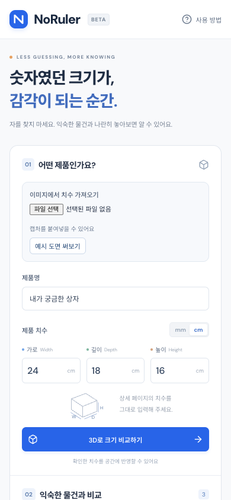
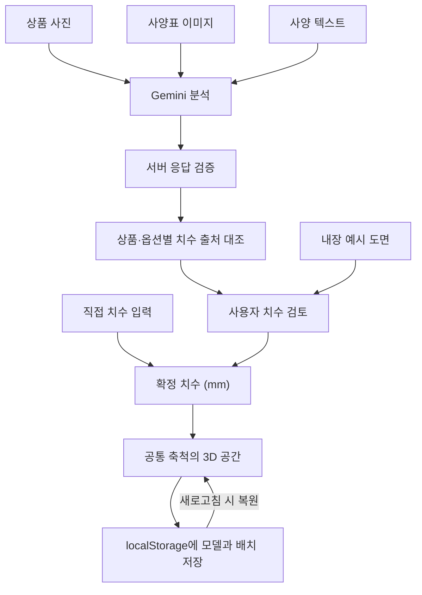

# NoRuler

> I don't want to find a ruler.

상품 사진·사양표에서 치수를 읽고, 익숙한 물건과 같은 축척의 3D 공간에서 크기를 비교합니다.


*예시 도면에서 확인한 치수로 받침대를 만들어 익숙한 물건 옆에 놓은 모습.*

**MIT · Node.js ≥ 22.18 · React + Three.js**

## 왜 만들었나요?

온라인 쇼핑에서 `50 × 20 × 8.2 cm`라는 숫자만 보고 모니터 받침대가 얼마나 큰지 떠올리기 어렵습니다. 상세 페이지에는 상품 사진, 치수선, 사양표가 한데 있고 같은 상품에도 크기 옵션이 여러 개 있습니다. 포장 치수나 부품 치수가 섞여 있으면 어느 숫자가 제품 전체를 가리키는지도 확인해야 합니다. NoRuler는 치수의 출처를 확인하고, 확인한 크기를 책상 위에 두는 물건과 비교할 수 있게 만들었습니다.

## 빠른 시작

Node.js 22.18 이상과 WebGL 2를 지원하는 브라우저가 필요합니다. 저장소를 내려받은 뒤 프로젝트 폴더에서 아래 명령을 실행합니다. 같은 컴퓨터의 브라우저에서 터미널에 표시된 `Local` 주소(기본값 `http://localhost:5173`)를 엽니다.

```sh
npm install
npm run dev
```

### A. 예시 도면으로 체험

**API 키 없이 전체 흐름을 체험할 수 있습니다.**

1. **예시 도면 써보기**를 클릭합니다. **원본 확대**에서 가로 `130 mm`와 높이 `35 mm`의 치수선을 확인합니다.
2. 높이 아래에서 **이 값 확인**을 누르고, 도면에 없는 깊이는 예시로 `50 mm`를 입력합니다. 제품명도 바꿀 수 있습니다.
3. **3D로 크기 비교하기**를 클릭합니다. `130 × 50 × 35 mm` 제품이 비교 공간에 추가됩니다. 프리셋을 추가하거나, 추가한 물건을 선택해 옮기고 돌려 봅니다.

제품명과 가로·깊이·높이를 입력해 사진 없이도 비교할 수 있습니다.

### B. 실제 상품 이미지 분석

프로젝트 루트에 `.env.local` 파일을 만들고 발급받은 키를 넣습니다.

```dotenv
GEMINI_API_KEY=발급받은_키
```

개발 서버를 재시작하고 PNG·JPG·WebP 이미지(파일당 최대 8 MB)를 선택한 뒤 **이미지 분석**을 누릅니다. **별도 치수 자료 추가**에서 사양표 이미지나 치수 텍스트도 넣을 수 있습니다. 분석 요청에 포함한 이미지와 텍스트는 Google Gemini로 전송됩니다.

분석 엔드포인트는 `npm run dev` 또는 빌드 후 `npm run preview`에서 Vite 미들웨어로 동작합니다. `dist/`만 정적으로 배포하면 예시와 직접 입력으로 비교할 수 있습니다.

## 주요 기능

### 3D 비교 공간

- A4 용지, 500 mL 물병, 스마트폰, 노트북, 키보드, 27인치 모니터를 같은 축척에 배치합니다. 직교 카메라로 정면·측면·위 등에서 보고, 물건을 옮기거나 돌리며 가까운 면에 붙일 수 있습니다. 조작은 실행 취소하거나 다시 실행할 수 있습니다.


*책상과 주변 물건을 같은 축척에 놓고 책상의 가로·깊이·높이를 확인합니다.*

### 이미지 분석과 치수 검토

- 사진 속 치수선과 사양표 근거를 축별로 보여줍니다. 값이 충돌하면 사용자가 근거를 보고 선택하고, 축 이름이 없는 치수는 가로·깊이·높이에 배정할 수 있습니다. 포장·부품 치수는 제품 전체 치수에서 제외합니다.


*시연용 분석 결과에서 치수선의 500 mm와 사양표의 510 mm를 비교하고 가로 값을 고릅니다.*

### 책상 형태 초안

- 지원하는 구조의 책상은 상품 이미지와 회전 가능한 3D 초안을 나란히 확인합니다. 시연 예시에서는 800·1000·1200 mm 옵션을 바꿔 보거나, **앞뒤 바꾸기**로 X자 보강대 방향을 수정할 수 있습니다.


*시연용 책상 이미지에서 1200 mm 옵션을 선택하고 초안의 구조를 확인합니다.*

### 모델 기록과 복원

- 비교한 제품을 모델 기록에서 다시 꺼내거나 내 프리셋에 등록합니다. 모델, 배치 위치, 회전, 시점과 표시 설정은 브라우저의 `localStorage`에 저장합니다. 기존 v1·v2 작업공간은 v3 형식으로 읽어 복원합니다.


*한 번 확인한 제품 치수와 책상 형태를 저장해 다음 비교에 다시 사용합니다.*

### 모바일 화면

- 모바일에서는 입력과 비교 공간을 세로로 표시합니다. 물건을 탭해 선택하고, 핀치로 확대하거나 두 손가락으로 시점을 이동할 수 있습니다.



*390 × 844 화면에서 스크롤 없이 예시 도면을 열 수 있습니다.*

## Gemini와 NoRuler 코드의 역할

상품 사진과 사양표의 위치 및 표기 형식이 일정하지 않아 이미지와 텍스트를 함께 읽는 Gemini를 사용합니다. Gemini는 치수와 형태 단서를 후보로 반환합니다. NoRuler는 값의 범위와 출처를 검사하고 충돌이나 누락을 검토 화면에 표시한 뒤, 유효한 치수를 비교 공간에 반영합니다.

| 처리 | 담당 | 코드 |
| --- | --- | --- |
| 숫자·단위, 대상 상품 영역, 보이는 부품 읽기 | Gemini 3.5 Flash-Lite | [서버 프롬프트와 JSON 스키마](server/imageDimensions.ts) |
| 응답 구조, 열거형, 수치 범위, 출처 ID 검사 | NoRuler | [`normalizeImageAnalysis`](src/imageDimensions.ts) |
| 치수선·사양표 대조, 값 충돌 감지, 포장·부품 제외, 축 미지정 값 처리 | NoRuler | [치수 정리](src/imageDimensions.ts), [축 배정](src/MeasurementReview.tsx) |
| 원본과 근거 표시, 확인이 필요한 축 표시, 사용자 선택·수정·누락 입력 | NoRuler | [이미지 검토](src/ImageInput.tsx), [치수 입력과 반영](src/App.tsx) |
| mm 변환, 공통 축척 적용, 책상 템플릿 생성 | NoRuler | [단위와 축척](src/domain.ts), [책상 생성](src/deskModel.ts), [3D 장면](src/scene.ts) |
| 가까운 면에 붙이기와 겹침 판정 | NoRuler | [`resolvePlacement`](src/placement.ts) |
| 실행 취소·다시 실행, 저장 형식 이전·복원 | NoRuler | [배치 이력](src/workspace.ts), [저장소](src/storage.ts) |

## 구조와 데이터 흐름



### 치수와 World Scale

내부 데이터는 **mm** 단위입니다. `WORLD_SCALE = 0.01`이므로 **1 world unit = 100 mm**이며, Three.js의 X·Y·Z는 각각 가로·높이·깊이에 대응합니다. 모든 물건은 같은 바닥과 10 cm 격자를 공유합니다. **전체 맞춤**은 카메라만 조정합니다. 직교 카메라는 화면이 확대되거나 축소돼도 물건 사이 크기 비율을 유지합니다.

각 축은 `0.1–10,000 mm` 사이의 값을 받습니다. mm와 cm를 전환해도 물리적 크기는 유지됩니다. `Escape` 또는 포인터 취소는 진행 중인 조작을 되돌립니다. 겹침을 해소할 수 없으면 조작을 시작한 위치로 돌아갑니다.

| 프리셋 | 가로 × 깊이 × 높이 (mm) | 기준 |
| --- | --- | --- |
| A4 용지 | 210 × 297 × 0.1 | 바닥에 놓인 A4, 두께는 가정값 |
| 500 mL 물병 | 65 × 65 × 210 | 일반적인 원형 물병 |
| 스마트폰 | 72 × 8 × 147 | 세워 놓은 6.1형 예시 |
| 노트북 | 304 × 215 × 16 | 덮개를 닫은 13형 예시 |
| 키보드 | 360 × 140 × 30 | 텐키리스 예시 |
| 27인치 모니터 | 615 × 200 × 455 | 스탠드를 포함한 예시 외형 |

프리셋은 크기 비교에 쓰는 대표 치수입니다. 실제 제품의 외형은 모델에 따라 다릅니다.

### 주요 파일

| 역할 | 파일 |
| --- | --- |
| 분석 요청, Gemini 응답 스키마 | [server/imageDimensions.ts](server/imageDimensions.ts) |
| 치수 후보 정규화와 출처 대조 | [src/imageDimensions.ts](src/imageDimensions.ts) |
| 파일 입력, 상품 영역 지정, 사양 검토 | [src/ImageInput.tsx](src/ImageInput.tsx), [src/ProductRegion.tsx](src/ProductRegion.tsx), [src/MeasurementReview.tsx](src/MeasurementReview.tsx) |
| 입력 폼과 연결, 책상 미리보기와 생성 | [src/App.tsx](src/App.tsx), [src/DeskPreview.tsx](src/DeskPreview.tsx), [src/deskModel.ts](src/deskModel.ts) |
| 단위와 검증, 공간 렌더링 및 조작 | [src/domain.ts](src/domain.ts), [src/scene.ts](src/scene.ts), [src/SceneViewer.tsx](src/SceneViewer.tsx), [src/placement.ts](src/placement.ts) |
| 모델 기록, 배치 이력과 저장 형식 이전 | [src/ModelLibrary.tsx](src/ModelLibrary.tsx), [src/workspace.ts](src/workspace.ts), [src/storage.ts](src/storage.ts) |

## 빌드와 테스트

```sh
npm run build
npm test
npx playwright install chromium --only-shell
npm run test:e2e
```

- `npm run build`는 TypeScript 검사와 Vite 프로덕션 빌드를 실행합니다.
- `npm test`는 단위 변환, 입력 검증, 3D 모델의 외형 치수, 배치 및 분석 응답 처리를 검사합니다. [단위 테스트](src/domain.test.ts)
- `npm run test:e2e`는 Chromium에서 이미지 검토, 모바일 터치 조작, 배치와 복원을 검사합니다. 위 설치 명령으로 테스트용 Chromium을 먼저 설치합니다. [브라우저 테스트](tests/comparison.spec.ts)
- `node --experimental-strip-types scripts/screenshots.ts`는 같은 Chromium을 사용해 `docs/images/`의 시연 화면을 다시 캡처합니다. 내장 도면과 시연용 분석 응답을 사용하므로 API 키가 필요 없습니다. [캡처 스크립트](scripts/screenshots.ts)

## 출처와 크레딧

| 구성 요소 | 라이선스 또는 사용 조건 | 출처 |
| --- | --- | --- |
| `react`, `react-dom` | MIT | [React](https://github.com/react/react) |
| `vite`, `@vitejs/plugin-react` | MIT | [Vite](https://github.com/vitejs/vite), [Vite React 플러그인](https://github.com/vitejs/vite-plugin-react) |
| `typescript` | Apache-2.0 | [TypeScript](https://github.com/microsoft/TypeScript) |
| `three`와 OrbitControls, TransformControls, RoundedBoxGeometry, CSS2DRenderer | MIT | [Three.js](https://github.com/mrdoob/three.js), [Three.js 애드온 소스](https://github.com/mrdoob/three.js/tree/r180/examples/jsm) |
| `lucide-react` 아이콘 | ISC, Feather에서 이어받은 부분은 MIT | [Lucide](https://github.com/lucide-icons/lucide) |
| `@playwright/test` | Apache-2.0 | [Playwright](https://github.com/microsoft/playwright) |
| `@types/node`, `@types/react`, `@types/react-dom`, `@types/three` | MIT | [DefinitelyTyped](https://github.com/DefinitelyTyped/DefinitelyTyped) |
| Google Gemini API | 외부 서비스 이용약관 적용 | [Gemini API 이용약관](https://ai.google.dev/gemini-api/terms) |
| DM Sans, Noto Sans KR | SIL Open Font License 1.1 | [DM Sans](https://github.com/google/fonts/tree/main/ofl/dmsans), [Noto Sans KR](https://github.com/google/fonts/tree/main/ofl/notosanskr) |

- 내장 [예시 도면](public/measurement-example.png)은 NoRuler 시연용으로 직접 그린 이미지입니다. README의 치수 검토·책상 초안 화면은 자체 제작한 입력 이미지와 테스트용 분석 응답으로 캡처했습니다.
- 구현과 문서 작성에 생성형 AI 코딩 도구의 도움을 받았습니다.

## 한계와 다음 작업

- 실제 이미지 분석에는 Gemini API 키와 로컬 Vite 서버가 필요합니다. 정적 배포에서도 분석하려면 별도 백엔드가 필요합니다.
- 상세 3D 초안은 X자 보강대를 포함한 특정 책상 구조를 지원합니다. 나머지 제품은 확인한 치수의 상자로 비교할 수 있습니다.
- 충돌 판정은 물체의 전체 외곽 상자를 사용합니다. 현재 배치에서 책상 아래 빈 공간에도 외곽 상자가 적용됩니다.
- 다음 검토 대상은 범용 이미지→3D 메쉬, 부품 단위 충돌 판정, 서버리스 분석 백엔드입니다.

## 라이선스

This project is licensed under the MIT License — see [LICENSE](LICENSE).
